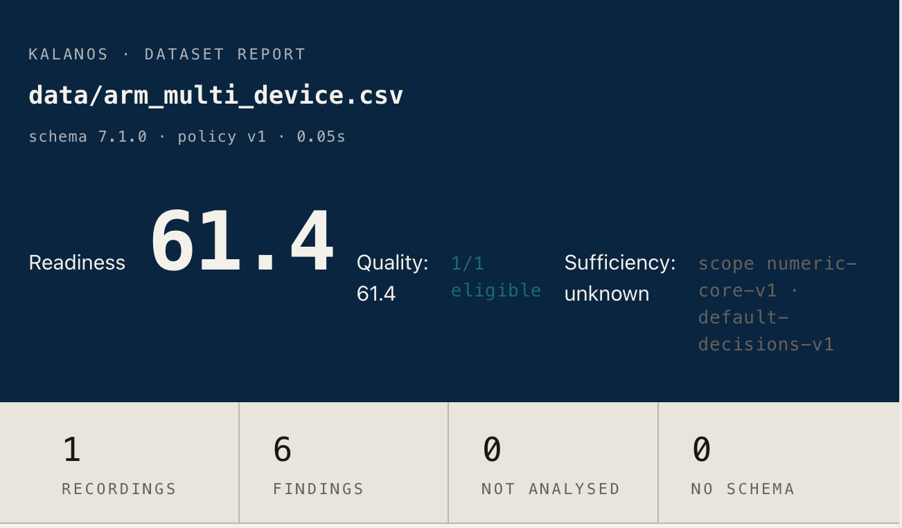
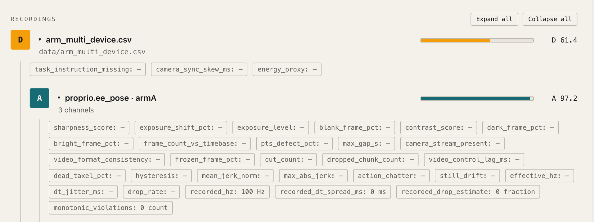

# Kalanos

[](https://pypi.org/project/kalanos/)
[](https://pypi.org/project/kalanos/)
[](https://github.com/KalanosAI/kalanos/actions/workflows/ci.yaml)
[](LICENSE)

Kalanos audits robot recordings for technical quality problems — dropped samples, flatlined sensors, clock jitter, missing evidence — before you commit them to a training set. It reports findings at episode, stream and channel level, shows which checks ran, and gives every episode a decision under a named evaluation scope. Use the HTML report to investigate and the JSON report to automate.

```bash
pip install kalanos
kalanos grade my_recordings/ --report report.html
```

Everything runs on your machine. Nothing is uploaded unless you choose to publish.

**Reads out of the box:** CSV, JSON, JSONL, delimited text, LeRobot directories.
**With extras:** HDF5, MCAP / ROS 2, Hugging Face datasets, sampled video checks. See [Install extras](#install-extras).



*Report summary for the sample fixture: readiness 61.4, 1 of 1 episodes eligible under `numeric-core-v1`. Sufficiency is reported separately as unknown — eligibility does not mean the dataset is sufficient for training.*

## Quickstart

Requires Python 3.10+. This walkthrough uses the released **0.8.0** package and a small official sample. No clone, account, API key or model service is needed.

```bash
python3 -m venv .venv
source .venv/bin/activate

python -m pip install "kalanos==0.8.0"
python -m pip show kalanos

python -c "from urllib.request import urlretrieve; urlretrieve('https://raw.githubusercontent.com/KalanosAI/kalanos/v0.8.0/tests/fixtures/arm_multi_device.csv', 'arm_multi_device.csv')"

kalanos grade arm_multi_device.csv --report report.html
kalanos grade arm_multi_device.csv --report report.json
kalanos inspect report.json
```

Open `report.html` in your browser. `kalanos inspect` prints a terminal summary of a saved JSON report.

<details>
<summary>Windows (PowerShell)</summary>

```powershell
py -3 -m venv .venv
.\.venv\Scripts\Activate.ps1
```

If PowerShell blocks activation, call `.\.venv\Scripts\python.exe` and `.\.venv\Scripts\kalanos.exe` directly instead of `python` and `kalanos`. The remaining commands are the same.

</details>

The sample is a **synthetic test fixture**: four interleaved arm streams with a flatlined channel, dropped samples and clock jitter, treated as one episode. It demonstrates parsing and findings, not detection accuracy or training performance. See the [fixture description](tests/fixtures/README.md).

### What you should see

```text
Assessment  Ready
Readiness   61/100
Episodes    1 - eligible 1 - review 0 - blocked 0 - unknown 0
Scope       numeric-core-v1

Flagged channels
  low signal-to-noise  5 of 11 channels  1 episode  Integrity
  repeated values      1 of 12 channels  1 episode  Integrity
```

Both commands exit `0`. The JSON records readiness `61.44832235703186`, a complete inventory and one `pass` episode. The flatlined `armB` z channel and five low signal-to-noise channels are **report-only** findings under this scope — a passing episode can still have quality problems worth inspecting before selection.



*Detail view: the recording scores 61.4 while the expanded `armA` stream scores 97.2. Cadence is shown as recorded (100 Hz); clock provenance is unknown, so this is not a capture-timing certification. Dashes mean not applicable or no evidence, not a pass.*

The full [HTML report](docs/examples/arm-audit/reports/arm-audit.html) and [JSON report](docs/examples/arm-audit/reports/arm-audit.json) from this run are included, generated with a clean install of 0.8.0 on macOS ARM64 / Python 3.14.7.

## Reading a decision

| Episode decision | Meaning under the selected scope | Next action |
|---|---|---|
| `pass` (shown as **eligible** in terminal output) | Required evidence is sufficient; no blocking or review decision remains | Inspect report-only findings and confirm the scope fits your use |
| `blocked` | A finding has an authorized blocking consequence | Fix or exclude the episode, then rerun |
| `review` | A finding needs a decision or supporting validation | Review the evidence and resolve it before selection |
| `unknown` | Required evidence is missing or unavailable | Supply the needed data, mapping or dependency, then rerun |

**Readiness** combines passing-episode quality with the passing share; blocked episodes contribute zero. It can be **undefined** when review or unknown decisions, or an incomplete inventory, prevent a supported whole-dataset value — read the reported reason rather than treating undefined as zero or as a pass. Full semantics: [docs/DECISIONS.md](docs/DECISIONS.md).

## Audit your own recordings

```bash
kalanos grade recording.csv --report recording.html
kalanos grade dataset/ --report dataset.json     # directories are walked recursively
kalanos grade dataset/ --report dataset.compact.json --compact   # short key aliases: a smaller file, for machines
kalanos profiles list                            # available evaluation scopes
kalanos adapters                                 # available readers
```

Start with a small local subset, check the inventory and skipped files, and pick a scope that matches your intended use. Typical uses: triaging a recording batch, investigating a sensor channel, or reviewing a vendor delivery. Compare runs only when scope and recorded identities are compatible.

### Install extras

| Need | Install |
|---|---|
| HDF5 reader | `python -m pip install "kalanos[hdf5]==0.8.0"` |
| MCAP / ROS 2 reader | `python -m pip install "kalanos[mcap]==0.8.0"` |
| Hugging Face access | `python -m pip install "kalanos[hf]==0.8.0"` |
| Optional numeric diagnostics | `python -m pip install "kalanos[numeric]==0.8.0"` |
| Sampled video checks, including LeRobot video | `python -m pip install "kalanos[video]==0.8.0"` |
| All extras | `python -m pip install "kalanos[all]==0.8.0"` |

A missing reader dependency prevents loading that format. A missing optional check is reported as unavailable; if the scope requires its capability, the missing evidence can make an episode `unknown`. Installing an extra does not change what a scope requires. See [metrics](docs/METRICS.md), [profiles](docs/PROFILES.md), [adapters](docs/ADAPTERS.md) and [diagnostics](docs/DIAGNOSTICS.md).

## Gate a CI pipeline

```bash
kalanos grade dataset/ --report audit.json --fail-on blocked,review,unknown
```

| Exit code | Meaning |
|---|---|
| `0` | The configured gate did not fail |
| `1` | The gate failed |
| `2` | Invalid configuration or operational failure |

The default gate is `blocked,unknown`; add `review` when reviews must be resolved before merge. An incomplete inventory also fails when `unknown` is included. This gate is a status gate, not a minimum-score threshold — the sample fixture still exits `0` under `blocked,review,unknown` because its findings are report-only.

## Local by default

Grading and report generation run entirely on your machine with no model API. The network is used only to install packages, fetch the public sample, or read remote sources you point Kalanos at; `--max-remote-gb` and `--max-remote-files` bound remote discovery. Start small rather than scanning a large remote dataset on a first run.

Publishing is opt-in. `kalanos grade --publish` or `kalanos publish REPORT.json` sends a report to your authenticated account on [hub.kalanos.ai](https://hub.kalanos.ai); it needs a Hub API key, and local datasets need a name. Report files can contain source paths, task instructions and diagnostic evidence — treat them as data and review them before sharing.

## What Kalanos does and does not tell you

Kalanos reports technical recording quality within the evidence and scope available. It does **not** establish task success, dataset representativeness, robot safety, or any training-performance guarantee.

- A `pass` means required evidence was sufficient under the scope, not that the recording is free of problems — read report-only findings.
- Timing interpretation depends on clock provenance. Unknown provenance means recorded cadence is reported, not certified.
- Sampled video checks do not inspect every frame by default.
- Statistical findings may require review or accepted validation before they can block an episode.
- The macOS commands above are tested; Linux and Windows variants follow the same CLI but were not separately verified for this release.

## Documentation and support

[Changelog](CHANGELOG.md) · [PyPI](https://pypi.org/project/kalanos/) · [Report schema](docs/SCHEMA.md) · [Decisions](docs/DECISIONS.md) · [Architecture](docs/ARCHITECTURE.md) · [Contributing](CONTRIBUTING.md) · [Security](SECURITY.md) · [Issues](https://github.com/KalanosAI/kalanos/issues)

Reproducibility: the sample run's [metadata and exit codes](docs/examples/arm-audit/provenance/run.json), [resolved dependencies](docs/examples/arm-audit/provenance/requirements-resolved.txt) and [verification notes](docs/examples/arm-audit/provenance/verification.txt) are included.

Licensed under [Apache-2.0](LICENSE).
