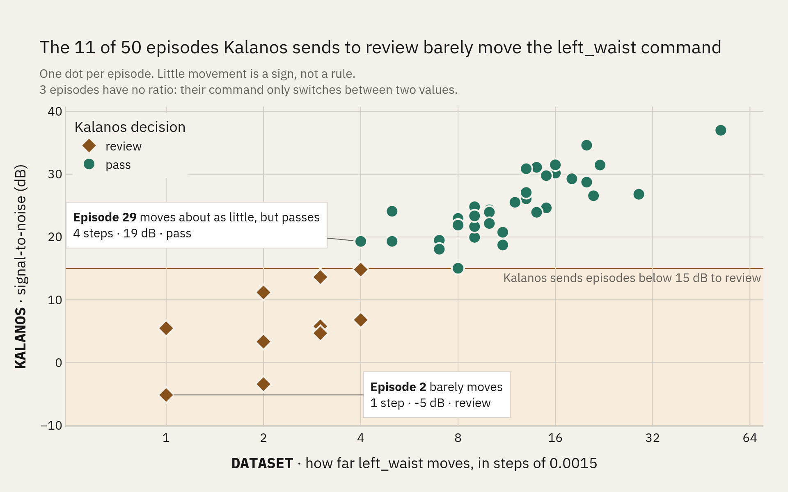

# Kalanos

[](https://pypi.org/project/kalanos/) [](https://pypi.org/project/kalanos/) [](https://github.com/KalanosAI/kalanos/actions/workflows/ci.yaml) [](https://github.com/KalanosAI/kalanos/blob/main/LICENSE)

Training a robot on ungraded data means finding flatlined sensors, dropped samples, and mistimed cameras after the training run is already spent.

- Scores LeRobot, HDF5, MCAP/ROS 2, CSV, and JSON datasets from 0–100 where the evidence supports a score. Decides every episode: pass, blocked, review, or unknown.
- Finds flatlined channels, dropped samples, clock jitter, and noisy commands. Each finding names the episode, stream, and channel behind it.
- Writes an HTML report to inspect and JSON to automate. Gate CI with `--fail-on`.
- Runs on your machine. Nothing is uploaded unless you publish, and local audits need no account or API key.
- Publishing to [hub.kalanos.ai](https://hub.kalanos.ai) is opt-in. You get a public report and a badge for the dataset card.

[](https://colab.research.google.com/github/KalanosAI/kalanos/blob/main/notebooks/kalanos_quickstart.ipynb)

## Get started

With Python 3.10+ in a virtual environment:

```bash
python -m pip install kalanos
kalanos grade ./my_recordings --report audit.html
```

Replace `./my_recordings` with a local dataset folder or recording file. Open `audit.html` in a browser. To use the results in code, set the output to `audit.json` instead.

Kalanos reads local LeRobot datasets, CSV, and JSON out of the box. For HDF5 or MCAP/ROS 2, install `"kalanos[hdf5,mcap]"` and see [adapters](https://github.com/KalanosAI/kalanos/blob/main/docs/ADAPTERS.md). For sampled camera checks, install `"kalanos[video]"` and choose a [vision profile](https://github.com/KalanosAI/kalanos/blob/main/docs/PROFILES.md).

## See what needs review

In the [Colab quickstart](https://github.com/KalanosAI/kalanos/blob/main/notebooks/kalanos_quickstart.ipynb), Kalanos checks 50 simulated ALOHA cube-transfer demonstrations: **39 pass, 11 need review**. Start with **episode 2**: its left-waist command barely moves and has low signal-to-noise. Compare it with **episode 29**, which also moves little but passes. The chart shows where to look, not proof of a fault.



<sub>One dot per episode with a measured ratio: 47 of 50. This run checks numeric signals, not cameras. An episode decision reflects the checks that ran, not task success or training performance.</sub>

## Go further

[Website](https://kalanos.ai) · [Public reports](https://hub.kalanos.ai/?utm_source=github&utm_medium=referral&utm_campaign=grader_readme&utm_content=public_reports) · [How decisions work](https://github.com/KalanosAI/kalanos/blob/main/docs/DECISIONS.md) · [GitHub Action](https://github.com/marketplace/actions/kalanos-robotics-dataset-audit) · [Experiment tracking](https://github.com/KalanosAI/kalanos-tracking) · [More notebooks](https://github.com/KalanosAI/kalanos/blob/main/notebooks/README.md) · [Apache-2.0 license](https://github.com/KalanosAI/kalanos/blob/main/LICENSE)

[Report a bug](https://github.com/KalanosAI/kalanos/issues/new/choose) · Private feedback: [hello@kalanos.ai](mailto:hello@kalanos.ai)

## Use Kalanos in your editor

The Kalanos plugin adds the [dataset audit skill](skills/audit-robot-dataset/SKILL.md) and a read-only MCP connection for published reports. It does not install the grader CLI.

- **Codex:** Add the GitHub catalog with `codex plugin marketplace add KalanosAI/kalanos`. In the Codex app's Plugins Directory, select **Kalanos AI** and install **kalanos**.
- **Claude Code:** Run `/plugin marketplace add KalanosAI/kalanos`, then `/plugin install kalanos@kalanos-ai`. Invoke it as `/kalanos:audit-robot-dataset`.
- **Cursor:** The portable plugin works in Cursor Desktop. Copy `plugin.json`, `mcp.json` and `skills/` into `~/.cursor/plugins/local/kalanos/` (copy, don't symlink) and reload the window; a Cursor Marketplace listing is not live yet. Or use the skill-only install below and add `https://mcp.kalanos.ai/mcp` as a Streamable HTTP server in Cursor’s MCP settings.
- **VS Code / Copilot:** Use the skill-only install and connect MCP separately.

### Install only the skill

From your project directory:

```bash
npx skills add KalanosAI/kalanos --skill audit-robot-dataset
```

Select your editor when prompted. Add `-a <agent>` to skip the prompt or `-g` to install for all projects. To refresh the skill, rerun the install command; the installed `metadata.version` shows which copy you have. Prefer a manual install? Copy the entire `skills/audit-robot-dataset/` folder into `.claude/skills/` for Claude Code, `.agents/skills/` for Codex or Cursor, or `.github/skills/` for VS Code with GitHub Copilot. Replace manual copies to update them.

For a fresh audit with either install, install the [tested Grader CLI version](https://pypi.org/project/kalanos/0.10.2/) in your local Python environment (`python -m pip install "kalanos==0.10.2"`). To look up published reports from a skill-only install, add `https://mcp.kalanos.ai/mcp` as a Streamable HTTP server in your editor's MCP settings. No Kalanos account or API key is required for public reports.

- **Local audit:** “Which episodes in `./my_recordings` should I review before training?”
- **Published report:** “Is there a published audit for `lerobot/pusht`? Which checks did it cover?”

Related: [LeRobot episode selection](https://github.com/KalanosAI/kalanos-mcp) and [attaching an audit to a training run](https://github.com/KalanosAI/kalanos-tracking).
